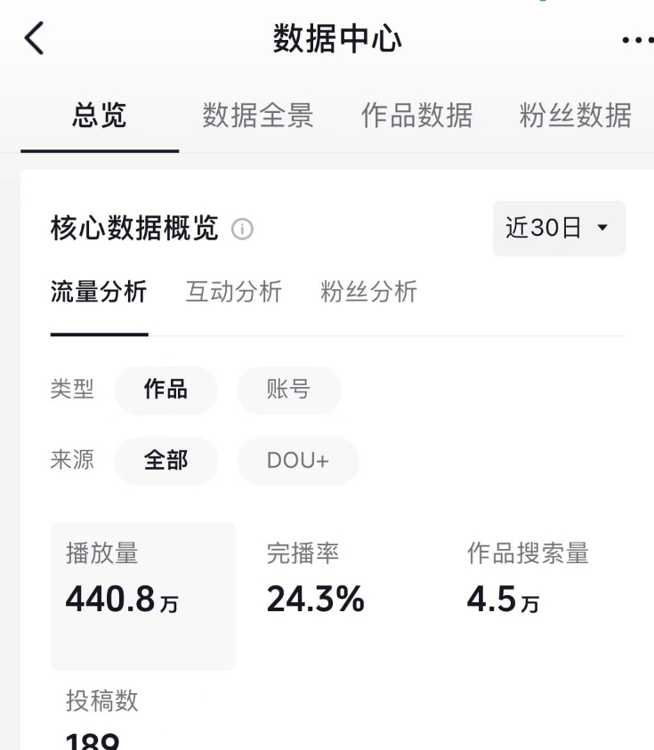

# 如何阅读作品数据面板

阅读数据时，先确认**统计范围和时间范围**，再比较不同作品的表现。

## 先看整体趋势

不要只看某一天的数字。连续观察一段时间，更容易理解内容变化。

> 图片与上下文一起阅读，避免脱离统计口径解读数字。

## 按顺序检查

1. 确认日期范围。
2. 查看作品数量。
3. 比较阅读与互动趋势。

---

这些步骤用于说明文章排版，不构成收益或流量承诺。
