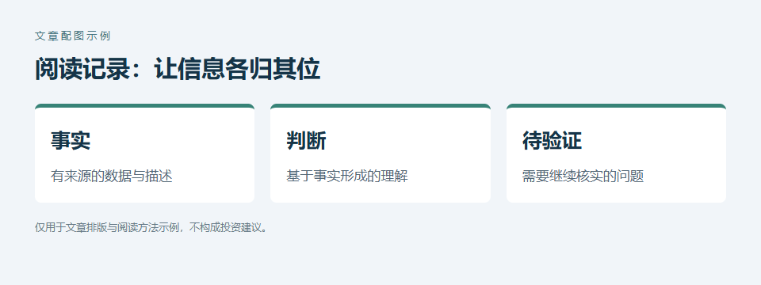
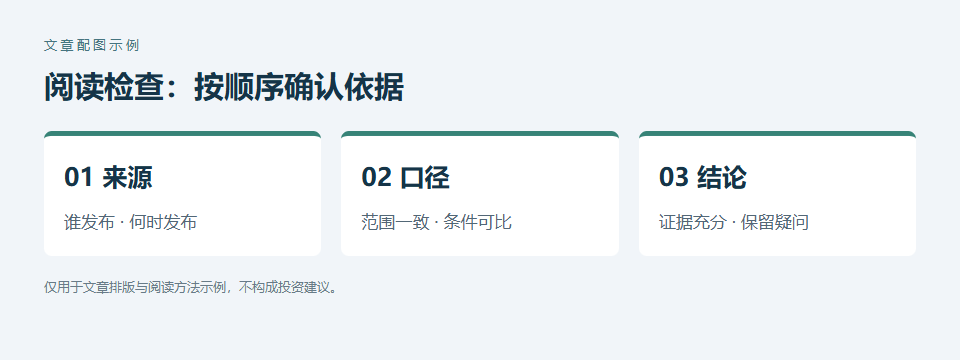

# 一、先记录事实，再形成判断

阅读一篇财经文章时，先确认**信息来源和统计口径**，再整理自己的理解。下面的示例仅用于展示文章结构，不构成投资建议。

原文中的数据、作者的观点和仍需核实的信息，可以分开记录。*个人判断需要保留验证空间。*

## 二、在图片之间展开说明

这段正文位于第一张图片之后、第二张图片之前。配图直接写在 Markdown 的对应位置，发布时会保留这个图文顺序。

1. 确认资料的发布时间和适用范围。
2. 检查数据是否可以直接比较。
3. 记录需要继续核实的问题。

> 一张图要结合前后的解释阅读，避免脱离上下文理解。

## 三、保留完整结尾

第二张图片后仍然可以继续写正文，也可以加入[雪球链接](https://xueqiu.com/)。替换示例内容时，把自己的图片放在原稿旁的 images 目录，再修改相应的图片路径。

本示例包含标题、段落、加粗、斜体、有序列表、引用、链接和两张段间图片。雪球会将不同级别的标题统一为平台小标题，列表保留编号，引用保留文字和段落。
